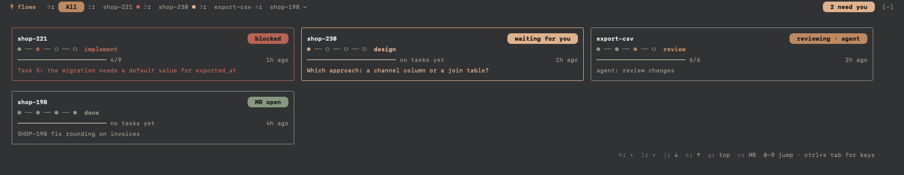
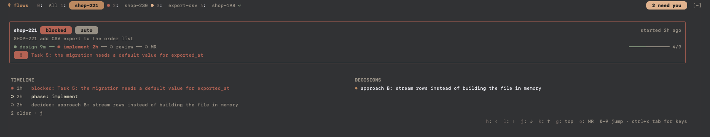

# flows

A Claude Code mod that shows every feature flow you run in parallel in a tabbed board above the prompt: what each flow is doing, which phase it is in, how far its tasks are, and which ones need you.

The flows come from `flow`, a command line tool (an [AXI](https://axi.md)) your workers report into. This mod is its board inside Claude Code.

> **Experimental.** `flow` is not published yet, so this mod is a test you can only run with a local build of it.



## Features

- **One card per flow:** name and state pill, a phase rail (design, implement, review, MR) with the current phase named, a task bar with the count and age, and one line: the blocker, the agent's task or the request.
- **Needs you first:** a card that waits for you or is blocked gets a border in its state color, and a pill at the right of the tab row counts them.
- **A tab per flow:** the flow's card with phase durations, its blocker, the newest timeline entries and its decisions.
- **Keyboard first:** digits jump to a tab straight from an empty prompt; with the band focused, vim keys move around.
- **Lives above the prompt:** full width, in every layout, and on top of whatever else a mod draws there.
- **Follows your Claude Code theme:** all colors come from the theme.

## Requirements

- **`flow`** (not published yet) on your `PATH`, or its path in the `flowPath` setting. The desktop app may not have `~/.cargo/bin` on its `PATH`.
- **Claude Code 2.1.299 or later** with function-hook plugins (mods). The mod API is in early access and may change between releases.
- **A Nerd Font** for the rounded pill ends and the mark in the tab row.

## Install

1. In Claude Code, add the marketplace and install the mod:
   ```
   /plugin marketplace add JanSuthacheeva/claude-code-mods
   /plugin install flows@claude-code-mods
   ```
2. Restart Claude Code and run `/flows`.

For development, link a clone of this repository instead:

```sh
ln -s "$PWD/claude-code-mods/flows" ~/.claude/skills/flows
```

## The board



| Part       | Meaning                                                                                                   |
| ---------- | --------------------------------------------------------------------------------------------------------- |
| Tab row    | `All` and one tab per flow; the active tab is a pill, a dot marks flows that need you, a tick done ones     |
| Card       | Name, state, phase rail, tasks, age, and the blocker, the agent's task or the request                     |
| Flow tab   | The flow's card with phase durations, then the three newest timeline entries and the last three decisions |

State colors: working and delegated in the accent color, waiting in warning, blocked and not responding in error, done in success.

Nine flows get a tab and a digit; more show as `+n` and are reached with `l`. When a flow is cleared with `flow clear`, its tab falls back to `All`.

## Keys

| Key     | Where                       | Does                                     |
| ------- | --------------------------- | ---------------------------------------- |
| `0`     | anywhere, also empty prompt | All                                      |
| `1`-`9` | anywhere, also empty prompt | that flow's tab                          |
| `h` `l` | band focused                | previous or next tab                     |
| `j` `k` | band focused                | next or previous card on All, or older and newer timeline entries on a flow's tab |
| Enter   | a focused card              | open that flow's tab                     |
| `g`     | band focused                | back to the top                          |
| `o`     | band focused                | open the flow's merge request            |

Focus the band with ctrl+x tab or a click; letters typed into the prompt stay in the prompt.

## Commands

- `/flows` shows or hides the board. Your choice is remembered across sessions.
- `/flows <name>` shows the board on that flow's tab.

## Settings

- `flowPath` (default `flow`): the `flow` binary.

## Development

```sh
claude plugin validate .
claude plugin test .
```
