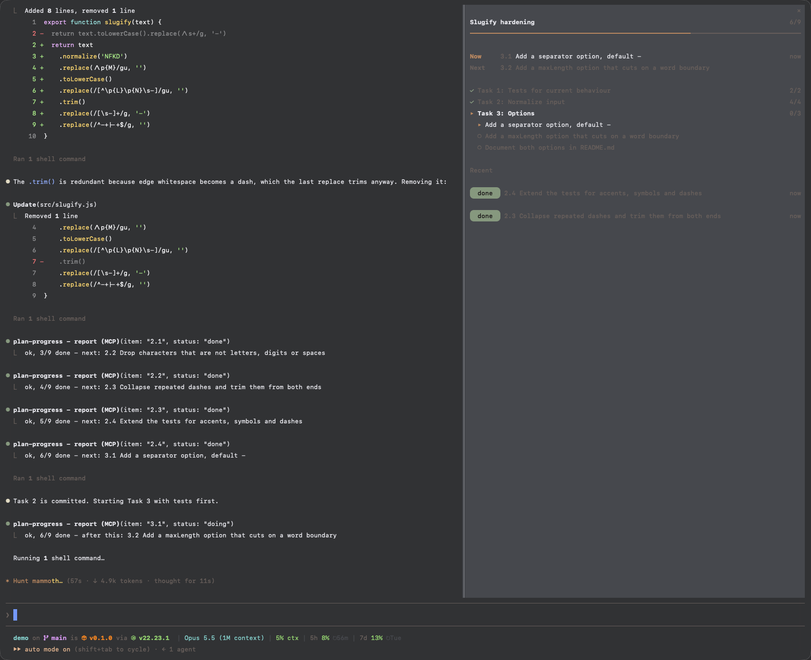
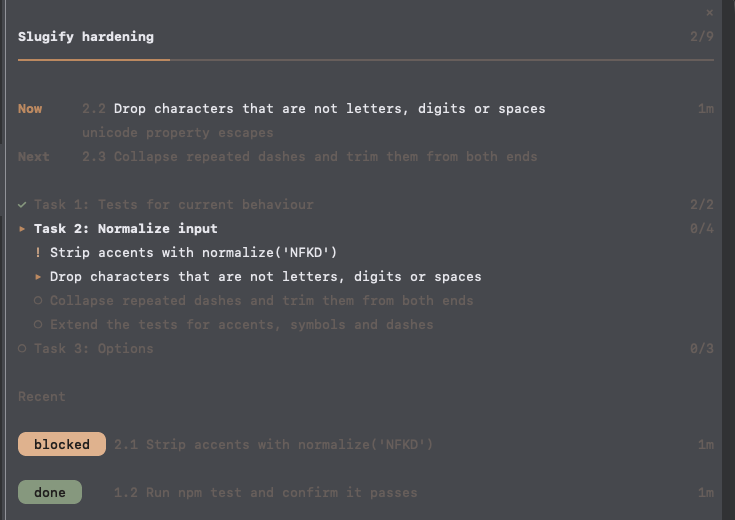
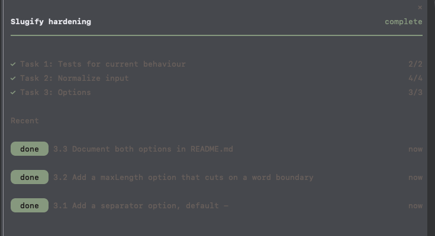

# plan-progress

A Claude Code mod that shows where you and Claude are in a plan file, in a side pane: what is done, what Claude is working on right now, and what is left.



## Features

- **Works with plain markdown plans:** any `- [ ]` checkbox counts, grouped under its nearest heading. Superpowers plans (`### Task N` with step checkboxes) and flat task lists both work.
- **Claude reports as it goes:** the mod gives Claude a small `report` tool. Claude marks an item `doing`, `done` or `blocked`, with an optional note. `done` ticks the checkbox in the plan file, so the file stays the record.
- **Survives sessions:** the tracked plan is remembered per project, so after `/clear`, a restart or the next day the pane picks it up again.
- **Follows your edits:** tick a box yourself and the pane updates within two seconds.
- **Follows your Claude Code theme:** all colors come from the theme, and `/theme` recolors the pane right away.
- **Light on tokens:** the tool schema is about 90 cached tokens per request, and a report costs about 55. Parsing, polling and drawing run in the mod and never reach the context.

## Requirements

- **Claude Code with function-hook plugins (mods)**, tested on 2.1.293. The mod API is in early access and may change between releases.

## Install

1. In Claude Code, add the marketplace and install the mod:
   ```
   /plugin marketplace add JanSuthacheeva/claude-code-mods
   /plugin install plan-progress@claude-code-mods
   ```
2. Restart Claude Code. The pane opens once Claude reports on a plan, or run `/plan-progress <file>`.

For development, link a clone of this repository instead:

```sh
ln -s "$PWD/claude-code-mods/plan-progress" ~/.claude/skills/plan-progress
```

## The pane

| Part   | Meaning                                                                                 |
| ------ | --------------------------------------------------------------------------------------- |
| Header | Plan title (its first `#` heading, or the file name) and checked items out of all items |
| Now    | The item Claude reported as `doing`, how long ago and its note. `Blocked` when stuck    |
| Next   | The open item after it. Without a report, the first open item                           |
| Groups | One row per heading with its count. Only the active group shows its items               |
| Recent | The last reports besides the current item, one row per item, with a status pill         |

A blocked item keeps its `!` until it is done, so you see what still needs you after Claude moves on.



The pills get rounded ends from Nerd Font glyphs, which most terminal setups with icons in the prompt already have. Without one, the ends show as boxes.

When every box is ticked, the bar and the header turn to the theme's success color.



Items are numbered `group.item` (`2.1`), or just `1`, `2`, `3` in a plan with a single group. Claude uses these refs, and so can you when talking about the plan.

Claude Code docks a pane opened on its own only in a terminal of 144 columns or more. Below that, `/plan-progress` shows it. Closing the pane keeps it closed until you run `/plan-progress` again.

## Commands

- `/plan-progress` shows or hides the pane.
- `/plan-progress <file>` tracks that plan in this project and shows the pane.
- `/plan-progress stop` stops tracking.

## The report tool

Claude sees it as `mcp__plan-progress__report`:

| Field    | Meaning                                                             |
| -------- | ------------------------------------------------------------------- |
| `plan`   | Path of the plan file. Only on the first call, or to switch plans   |
| `item`   | A ref like `2.1`, a `group / item` pair, or part of the item's text |
| `status` | `doing`, `done` or `blocked`                                        |
| `note`   | Optional, a few words on what is happening                          |

It answers in one line, such as `ok, 4/9 done - after this: 2.3 Step 3: Commit`. An item that matches several checkboxes is refused with the candidates listed, so no wrong box gets ticked. A heading as `item` covers all its checkboxes.

## Storage

The checkboxes live in the plan file. The tracked plan, the current item and the recent reports live in the mod's store, keyed by the project folder.

## Development

```sh
claude plugin validate .
claude plugin test .
```
